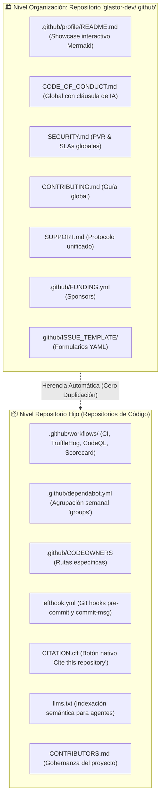

# ⚔️ @glastor-dev/samurai

> **Enterprise GitHub 2026 Standards, DevSecOps & Governance Generator for Deno,
> Rust, Node, Python & Go.**\
> Basado en la arquitectura de gobernanza y DevSecOps de
> [glastor-dev/glastor-dev](https://github.com/glastor-dev/glastor-dev).

[](https://jsr.io/@glastor-dev/samurai)
[](https://deno.land)
[](LICENSE)
[](https://docs.github.com)
[](https://github.com/glastor-dev/samurai)

---

## 🌟 La Arquitectura Híbrida de Élite (GitHub 2026)

Este generador implementa el **Enfoque Híbrido**, la arquitectura estándar
utilizada por las organizaciones de ingeniería de software más avanzadas del
mundo:



---

## 🚀 Nuevas Funcionalidades Implementadas

### 1. 🧙‍♂️ Asistente Interactivo (`wizard`)

Ejecuta un asistente guiado por terminal para configurar paso a paso la
arquitectura, el idioma, el stack y los hooks:

```bash
deno task wizard
# O vía JSR:
deno run -A jsr:@glastor-dev/samurai wizard
```

### 2. 🩺 Auditor de Salud y Cumplimiento (`doctor`)

Audita cualquier repositorio frente a los 9 estándares oficiales de GitHub 2026
y emite una calificación (0–100%):

```bash
deno task doctor
# O vía JSR:
deno run -A jsr:@glastor-dev/samurai doctor
```

> Resultado en este repositorio: **100/100 (100%) - Grade A+ (Elite)**.

### 3. 🧠 Detección Inteligente Multi-Stack

Detecta automáticamente el lenguaje de tu proyecto (**Deno, Rust,
Node/TypeScript, Python, Go**) y adapta tanto `ci.yml` (comandos de test y lint)
como `dependabot.yml` (ecosistemas específicos):

```bash
# Sobrescribir stack manualmente si se desea:
deno task hybrid --stack rust
deno task hybrid --stack python
deno task hybrid --stack node
```

### 4. 🌐 Soporte Bilingüe (`--lang en | es`)

Genera toda la documentación y políticas de seguridad en Español o Inglés:

```bash
deno task hybrid --lang en
deno task hybrid --lang es
```

### 5. 🪝 Automatización de Git Hooks con Lefthook

Incluye configuración nativa de `lefthook.yml` para validar **Conventional
Commits** y ejecutar formato/linters en pre-commit:

```bash
# Para omitir hooks locales si se desea:
deno task hybrid --no-hooks
```

---

## ⚡ Modos de Generación

### 1. 🌟 Enfoque Híbrido (Para Repositorios Hijos en tu Organización)

Genera **únicamente la infraestructura local obligatoria** (Workflows,
Dependabot, CODEOWNERS, CITATION.cff, llms.txt, CONTRIBUTORS.md, lefthook.yml),
heredando el Código de Conducta y la Seguridad desde la organización:

```bash
# Vía JSR / Zero-install:
deno run -A jsr:@glastor-dev/samurai hybrid

# Vía local:
deno task hybrid
```

---

### 2. 🏛️ Repositorio de Organización (`glastor-dev/.github`)

Genera el paquete completo para el repositorio especial `.github` (incluyendo la
portada de organización interactiva con diagrama Mermaid, Código de Conducta
global, Seguridad, Soporte, Patrocinio y Formularios de Issues):

```bash
# Exportar a una carpeta lista para subir a GitHub:
deno task org-init --dir ./glastor-dev-dot-github
```

---

### 3. 📦 Modo Standalone (Para proyectos aislados fuera de la organización)

Genera el catálogo autónomo completo de **23 archivos** directamente en el
repositorio actual:

```bash
deno run -A jsr:@glastor-dev/samurai init
# o local:
deno task init
```

---

## 📋 Catálogo Completo de Archivos

| Archivo                                      | Nivel Arquitectónico | Propósito en GitHub 2026                                               |
| :------------------------------------------- | :------------------: | :--------------------------------------------------------------------- |
| `.github/profile/README.md`                  |  **Org (.github)**   | Portada institucional con diagrama Mermaid y badges de estado          |
| `CODE_OF_CONDUCT.md`                         |   **Org / Global**   | Contributor Covenant 2.1 + Cláusula obligatoria de transparencia IA    |
| `SECURITY.md`                                |   **Org / Global**   | Private Vulnerability Reporting (PVR), estándares CVSS v4 y SLA 24-48h |
| `CONTRIBUTING.md`                            |   **Org / Global**   | Guía de Clean Code, Semantic Branching y Conventional Commits          |
| `SUPPORT.md`                                 |   **Org / Global**   | Soporte mediante GitHub Discussions y acuerdos de servicio             |
| `.github/FUNDING.yml`                        |   **Org / Global**   | Botón "Sponsor" con canales GitHub Sponsors y Open Collective          |
| `.github/PULL_REQUEST_TEMPLATE.md`           |   **Org / Global**   | Checklist DevSecOps, breaking changes y validación de código IA        |
| `.github/ISSUE_TEMPLATE/*.yml`               |   **Org / Global**   | Formularios interactivos YAML para bugs y feature requests             |
| `.github/workflows/ci.yml`                   | **Local (Híbrido)**  | Pipeline CI multi-stack con concurrencia y `permissions: read-all`     |
| `.github/workflows/security-audit.yml`       | **Local (Híbrido)**  | DevSecOps continuo: escaneo de secretos con TruffleHog OSS             |
| `.github/workflows/codeql.yml`               | **Local (Híbrido)**  | Análisis estático SAST avanzado oficial de GitHub                      |
| `.github/workflows/scorecard.yml`            | **Local (Híbrido)**  | Auditoría de cadena de suministro OpenSSF Scorecard                    |
| `.github/workflows/dependabot-automerge.yml` | **Local (Híbrido)**  | Auto-merge probado para parches menores de dependencias                |
| `.github/dependabot.yml`                     | **Local (Híbrido)**  | Dependabot v2 agrupado (`groups`) adaptado al stack tecnológico        |
| `.github/CODEOWNERS`                         | **Local (Híbrido)**  | Asignación estricta de revisores por ruta                              |
| `lefthook.yml`                               | **Local (Híbrido)**  | Enforzamiento ultra-rápido de Conventional Commits y linters           |
| `CITATION.cff`                               | **Local (Híbrido)**  | Formato CFF 1.2.0 que activa el botón "Cite this repository"           |
| `CITATION.md`                                | **Local (Híbrido)**  | Formatos BibTeX, APA 7ª e IEEE                                         |
| `llms.txt`                                   | **Local (Híbrido)**  | Estándar de indexación semántica para agentes autónomos y LLMs         |
| `CONTRIBUTORS.md`                            | **Local (Híbrido)**  | Gobernanza técnica del proyecto y hoja de ruta de sostenibilidad       |

---

## 🛠️ Publicación en JSR

```bash
# 1. Auditar y verificar calidad
deno task doctor
deno task test

# 2. Publicar en JSR
deno publish
```

---

© 2026 Andrés Antonio Cardoso / GLASTOR-DEV. Licenciado bajo Apache-2.0.
